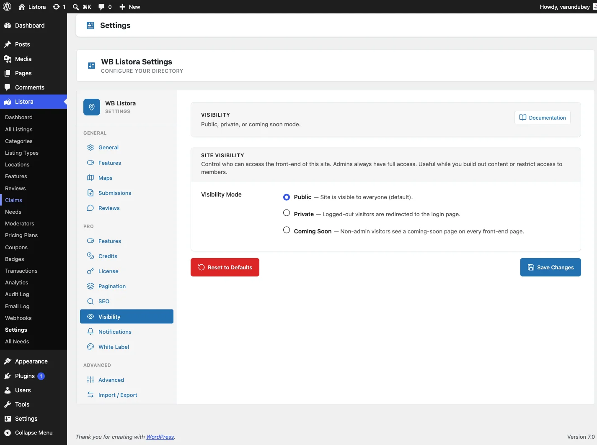

# Coming Soon Mode

> **Availability:** Pro only. Requires [WB Listora Pro](../getting-started/activating-pro.md). Free sites are always publicly visible once the directory page is published.

## What it does

Coming Soon Mode hides your directory from the public while you set up content, configure settings, and import listings. Users with the `manage_listora_settings` capability (administrators) keep full access. Everyone else, including logged-in members, sees a "Coming Soon" page instead of the directory.

There is also a **Private** mode that sends logged-out visitors to the login page and lets every logged-in member in - useful for members-only directories. Both modes can cover just the directory or the whole site.

## Why you'd use it

- Set up a complete directory before going public - no half-finished pages visible to visitors or search engines.
- The Coming Soon page is noindex by default, keeping your directory out of Google until it's ready.
- Private mode creates a gated directory accessible only to registered users.
- Private mode lets clients or stakeholders preview the directory with an ordinary member account, without making it public.

## How to use it

### For site owners (admin steps)

1. Go to **Listora → Settings → Visibility**. The tab is always there while Pro is active; there is no Features toggle to switch on first.
2. Under **Site Visibility**, choose a **Visibility Mode**:
   - **Public** - the directory is visible to everyone (default).
   - **Private** - logged-out visitors who open your directory are sent to the login page and back to the page they asked for after logging in. Every logged-in user can see it.
   - **Coming Soon** - every visitor except administrators sees the Coming Soon page, logged-in members included.
3. Choose what it **Applies To**:
   - **Directory only** (default) - listings, directory pages, member listing tabs, listing search, sitemaps and the API are hidden. The rest of your site stays public.
   - **Whole site** - every front-end page is hidden, not just the directory.
   The setting has no effect while the mode is Public. A site that was already Private or Coming Soon before this option existed was set to **Whole site** on update, so nothing it hid becomes visible.
4. Save settings.

**Who can bypass Coming Soon and Private mode:**

Users with the `manage_listora_settings` capability (administrators) see everything in every mode. In Private mode, any other logged-in user with the standard `read` capability (every role from Subscriber up) can see the directory too. A logged-in user without it gets an "Access denied" page.

**The Coming Soon page:**

The built-in page shows the heading "Our Directory is Coming Soon!", a short message and a link back to your site, and the browser tab reads "Your Site Name - Coming Soon". It includes a `noindex, nofollow` meta tag to keep search engines out, and it follows the visitor's `prefers-color-scheme` setting for dark mode.

The page is built in, so there is no template to override. Developers can change which requests are gated with the `wb_listora_pro_visibility_should_gate` filter.

**Switching back to public:**

Change **Directory Visibility** back to **Public** and save. The directory is immediately accessible to all visitors.

### For end users (visitor/user-facing)

In Coming Soon mode, visitors to a directory page (a listing URL, an archive, a taxonomy page or a page with a Listora block) see the Coming Soon page. With **Whole site** selected, they see it on every page.

In Private mode, visitors are redirected to the WordPress login page. After logging in, they are sent back to the page they requested.

## Tips

- Use Coming Soon mode during a migration from another directory plugin. Import and verify all content before going public.
- With **Directory only**, your regular WordPress pages stay public. Only directory pages are intercepted. Choose **Whole site** to hide those too.
- To let clients preview the directory without admin access, use Private mode and give them a Subscriber account. Coming Soon mode shows its page to every non-administrator, even when logged in.
- Switch to Public mode at a specific date and time by scheduling it manually - Coming Soon has no built-in countdown timer, but you can schedule an admin task or use a WordPress scheduler plugin.
- Private mode lets in anyone logged in who has the standard `read` capability, which every default WordPress role has.

## Common issues

| Symptom | Fix |
|---------|-----|
| Admin still seeing Coming Soon page | Confirm your user account has the `manage_listora_settings` capability - Administrators have it by default |
| Regular site pages showing Coming Soon | **Applies To** is set to **Whole site**. Switch it to **Directory only**. If it is already Directory only, a page with a Listora block counts as a directory page. |
| A logged-in member sees Coming Soon | By design: only administrators bypass it. Use Private mode for member access. |
| Coming Soon page not showing your site name | Ensure your site name is set under **Settings → General → Site Title** |
| Google still indexing the directory | Coming Soon adds `noindex` to the page; it may take Google several weeks to deindex existing pages |

## Related features

- [White Label](white-label.md)
- [License Management](../getting-started/pro-license.md)
