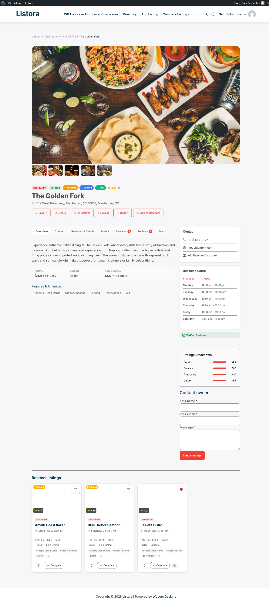

# Contact Form

> **Availability:** Free. Every message is also saved as a lead, so listing owners and site owners can read it later.

Every listing page has a **Contact owner** form. A visitor sends a message, the listing owner gets it by email, and Listora saves a copy as a lead. Owners read their leads under **My Dashboard > Leads**, and you read all of them under **Listora > Listings > Leads**.



## What the visitor sees

The form sits on the listing page after the listing fields. It asks for:

- **Your name** (required)
- **Your email** (required)
- **Phone (optional)**
- **Message** (required)

After a successful send the page shows "Your message has been sent to the listing owner."

The form is not shown to the listing owner on their own listing. It is also hidden between two members when one has blocked the other (see [Member Blocking](member-blocking.md)). A blocked member who still posts to the route gets "This message cannot be sent."

A listing the visitor cannot see, such as a draft or a missing one, answers "Listing not found."

## What the listing owner gets

- An email at the owner's WordPress account email, with the sender's name, email, phone, the message and a link to the listing.
- The email subject is `New message from {sender} about {listing title}`.
- `Reply-To` is set to the sender, so replying in your mail app goes straight to the visitor. The owner's address is never shown on the page.
- The same message under **My Dashboard > Leads**, with a **Reply by email** button and a phone button when a phone number was given. Owners can filter by listing.

The email is branded like the rest of Listora's mail. Edit its subject and body under **Listora > Settings > Email Templates**; it is the **New message from a visitor** email in the Listings group. See [Email Templates](email-templates.md). Every send is listed in the [Email Log](email-log.md).

The owner's My Dashboard shows the **Leads** tab while the contact form is on and the member has leads or owns a listing in any status except trash.

## Where site owners read leads

Open **Listora > Listings > Leads**. The table shows when the message arrived, who sent it, which listing it was for and the message. You can:

- Filter by date range (all, last 7, 30 or 90 days) and by listing ID or title.
- Search names, emails and messages.
- Reply by email.
- Delete a lead. This removes it for good, and the listing owner can no longer see it either.

When a listing changes hands, through a claim or an author change, its leads move to the new owner.

## Retention and privacy

- Leads are kept for **12 months** by default. Change it with **Keep leads for** at the top of **Listora > Listings > Leads**: 3, 6, 12 or 24 months, or **Until deleted**. Saving a shorter period removes older leads straight away; the daily cleanup also removes them as they age out.
- Leads are included in the WordPress personal data tools. **Tools > Export Personal Data** adds a "contact messages" group (listing, name, phone, message, date) for the sender's email address, and **Tools > Erase Personal Data** deletes every lead sent from that email address or by that member.
- Deleting a listing deletes its leads.
- A lead stores the sender's name, email, phone, message and send time, plus the member ID when the sender was logged in.

See [Privacy Tools](../developer-guide/privacy-tools.md).

## Turn the form off

Switch off **Contact Owner Form** under **Listora > Settings > Features**. The form disappears from listings, the **Leads** tab disappears from My Dashboard, and the REST route refuses messages with "Contacting listing owners is turned off on this site." Leads already saved stay in **Listora > Listings > Leads**.

## Spam protection and limits

Each message passes these checks before it is saved or emailed:

| Check | What it does | How to change it |
|---|---|---|
| Hidden field | Bots that fill it get a normal-looking success reply, and nothing is saved or sent. | Built in |
| Keyword list | Rejects messages containing words such as casino or viagra. | `wb_listora_antispam_keyword_blacklist` filter |
| Link limit | Rejects messages with more than 3 links. | `wb_listora_antispam_max_urls` filter |
| Akismet | Checks the message when Akismet is active. If Akismet is down, the message goes through. | Akismet plugin |
| Sender limit | 3 messages per hour to one listing from one sender. A logged-in member is counted by account, a guest by IP address. Over the limit returns HTTP 429. | `wb_listora_contact_rate_limit_identity` filter |
| Listing daily cap | 20 messages per listing per day from everyone. Over the cap returns HTTP 429. | `wb_listora_contact_form_per_listing_daily_cap` filter |

People who can edit others' listings skip the keyword, link and Akismet checks. See [Spam Protection](spam-protection.md) and [Rate Limiting](rate-limiting.md).

## REST API

| Method | Route | Who | What it does |
|---|---|---|---|
| `POST` | `/listora/v1/listings/{id}/contact-form` | Visitors with the form's per-listing nonce, or a signed-in app | Send a message. Fields: `name`, `email`, `message`, optional `phone`. |
| `GET` | `/listora/v1/leads` | Signed-in users | Leads the user's listings received; every lead for site managers. Filters: `listing_id`, `search`, `after`, `before`, `page`, `per_page` (1 to 100, default 20). Totals come back in the `X-WP-Total` and `X-WP-TotalPages` headers. |
| `GET`, `DELETE` | `/listora/v1/leads/{id}` | The listing owner or a site manager | Read or delete one lead. Anyone else gets 404. |

See the [REST API reference](../developer-guide/rest-api.md).

## Developer hooks

```php
// Refuse a message before it is saved (return a WP_Error).
add_filter( 'wb_listora_before_contact_form_submit', function ( $check, $listing_id, $lead, $request ) {
	if ( str_contains( $lead['message'], 'free money' ) ) {
		return new WP_Error( 'my_spam', 'Message refused.', array( 'status' => 400 ) );
	}
	return $check;
}, 10, 4 );

// Raise the daily cap for one listing.
add_filter( 'wb_listora_contact_form_per_listing_daily_cap', function ( $cap, $listing_id ) {
	return 123 === $listing_id ? 50 : $cap;
}, 10, 2 );

// BCC every owner email.
add_filter( 'wb_listora_contact_form_email_headers', function ( $headers, $post ) {
	$headers[] = 'Bcc: archive@example.com';
	return $headers;
}, 10, 2 );
```

| Hook | Type | What it does |
|---|---|---|
| `wb_listora_render_contact_form` | filter | Whether the form renders. Defaults to the **Contact Owner Form** switch. |
| `wb_listora_before_contact_form_submit` | filter | Refuse a message with a `WP_Error`. Receives the check result, listing ID, lead array and request. |
| `wb_listora_after_contact_form_submit` | action | Fires after the lead is saved. Receives the listing ID, the lead (`name`, `email`, `phone`, `message`, `lead_id`) and the request. The owner email, Free analytics and Pro hooks run from here. |
| `wb_listora_contact_form_per_listing_daily_cap` | filter | The per-listing daily cap (default 20). |
| `wb_listora_contact_rate_limit_identity` | filter | Who a sender counts as for the hourly limit. |
| `wb_listora_contact_form_email_headers` | filter | Headers on the owner email, including `Reply-To`. |
| `wb_listora_email_subject_lead_received` | filter | The owner email subject. |

## Related

- [Lead Forms](lead-forms.md) - what changed in 2.0.0 and what Pro adds.
- [Email Templates](email-templates.md) - edit the owner email.
- [Spam Protection](spam-protection.md) and [Rate Limiting](rate-limiting.md)
- [Member Blocking](member-blocking.md)
- [Analytics](analytics.md) - leads counted per listing.
